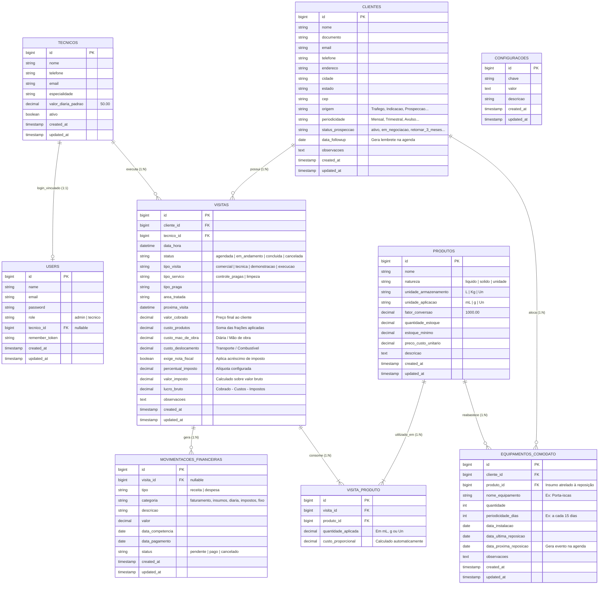
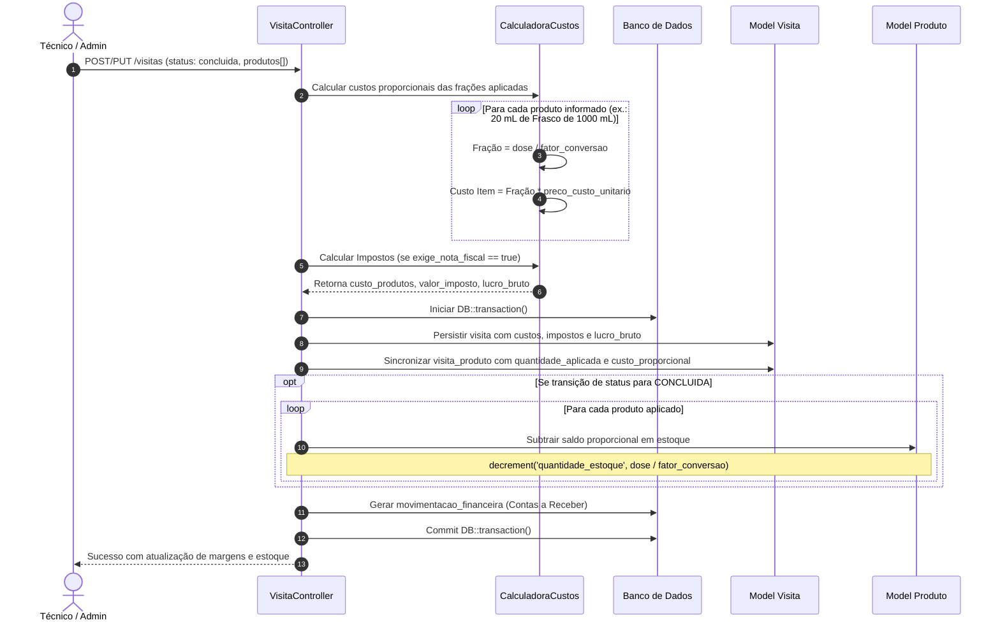
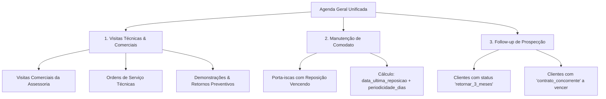

# ARCHITECTURE.md — Arquitetura de Software e Fluxos do ERP Alaris

Este documento detalha o desenho arquitetural, relacionamentos de entidades e fluxos operacionais críticos do **ERP Alaris** (anteriormente Biosp).

---

## 1. Visão Arquitetural Geral

O ERP Alaris adota o padrão arquitetural clássico do ecossistema Laravel (MVC moderno com Blade Server-Side Rendering e enriquecimento progressivo via JavaScript Vanilla e Tailwind CSS v4).

```
                      ┌────────────────────────────────────────┐
                      │          Navegador Web / Mobile         │
                      │  (Blade SSR + Vanilla JS + Tailwind)    │
                      └──────────────────┬─────────────────────┘
                                         │  HTTP / HTTPS / JSON Polling
                                         ▼
                      ┌────────────────────────────────────────┐
                      │          Rotas & Middlewares           │
                      │   (web.php, auth, role:admin/tecnico)  │
                      └──────────────────┬─────────────────────┘
                                         │
                                         ▼
                      ┌────────────────────────────────────────┐
                      │         Controllers (HTTP Layer)       │
                      │   Visita, Cliente, Comodato, Produto,  │
                      │   Financeiro, Agendamento, Tecnico...  │
                      └───────────┬────────────────┬───────────┘
                                  │                │
                        (Reads)   │                │ (Writes com DB::transaction)
                                  ▼                ▼
                      ┌────────────────────────────────────────┐
                      │             Eloquent ORM               │
                      │  Modelos com Casts, Scopes, Relaciona- │
                      │  mentos e Políticas de Autorização     │
                      └──────────────────┬─────────────────────┘
                                         │
                                         ▼
                      ┌────────────────────────────────────────┐
                      │         Base de Dados Relacional       │
                      │             (SQLite / MySQL)           │
                      └────────────────────────────────────────┘
```

---

## 2. Diagrama Entidade-Relacionamento (ERD)



---

## 3. Fluxos Operacionais e de Negócio Críticos

### 3.1. Ciclo de Conclusão de Visita, Conversão Fracionada e Formação de Custo



---

### 3.2. Fluxo da Agenda Geral Unificada

O módulo de agendamentos (`/agendamentos`) consolida três origens de dados operacionais e comerciais:



---

### 3.3. Fluxo de Geração de Proposta Comercial (Regra de Sigilo)

Para garantir proteção comercial e conformidade com as diretrizes da Alaris Service, dados sensíveis de custos internos nunca são expostos ao cliente final:

```
┌────────────────────────────────────────────────────────────────────────┐
│                        Dados da Visita / OS                            │
│  - Metragem: 250 m²             - Praga: Baratas Germânicas            │
│  - Insumo: 30 mL Fipronil       - Custo Produto: R$ 4,50               │
│  - Diária Técnico: R$ 50,00     - Deslocamento: R$ 20,00               │
│  - Imposto (14%): R$ 42,00      - Preço Final Cobrado: R$ 300,00       │
└───────────────────────────────────┬────────────────────────────────────┘
                                    │
               ┌────────────────────┴────────────────────┐
               ▼                                         ▼
┌──────────────────────────────┐        ┌──────────────────────────────┐
│  Painel Interno (Admin)      │        │  Proposta / Visão do Cliente │
│  (Visibilidade Completa)     │        │  (Sigilo Comercial Absoluto) │
├──────────────────────────────┤        ├──────────────────────────────┤
│ • Preço Cobrado: R$ 300,00   │        │ • Serviço: Controle de Pragas│
│ • Custo Insumos: R$ 4,50     │        │ • Metragem: 250 m²           │
│ • Mão de Obra: R$ 50,00      │        │ • Garantia: 90 dias          │
│ • Deslocamento: R$ 20,00     │        │                              │
│ • Impostos (NF): R$ 42,00    │        │                              │
│ ──────────────────────────── │        │ ──────────────────────────── │
│ • Lucro Bruto: R$ 183,50     │        │ • VALOR FINAL: R$ 300,00     │
│ • Margem: 61.1%              │        │                              │
└──────────────────────────────┘        └──────────────────────────────┘
```

---

## 4. Arquitetura Frontend: Temas, Polling e Reatividade

```
┌──────────────────────────────────────────────────────────────┐
│                    resources/js/app.js                       │
│                                                              │
│  ┌────────────────────────────────────────────────────────┐  │
│  │ 1. Theme Engine                                        │  │
│  │    • Lê 'theme' do localStorage (padrão: light)        │  │
│  │    • Aplica [data-theme="dark"] ou padrão light no html│  │
│  │    • Alterna ícones de Sol e Lua                       │  │
│  └────────────────────────────────────────────────────────┘  │
│  ┌────────────────────────────────────────────────────────┐  │
│  │ 2. Polling de Notificações (30s)                       │  │
│  │    • GET /notificacoes                                 │  │
│  │    • Recebe contagens { atrasadas, proximas, estoque,  │  │
│  │      comodato_reposicao, followups_pendentes }         │  │
│  │    • Alimenta badge no header e dropdown contextual    │  │
│  └────────────────────────────────────────────────────────┘  │
│  ┌────────────────────────────────────────────────────────┐  │
│  │ 3. Gerenciador Dinâmico de Produtos e Custos           │  │
│  │    • addProdutoRow() injeta linha de produto e dose    │  │
│  │    • Atualiza subtotal estimado de custos em tela      │  │
│  │    • Calcula acréscimo imediato ao marcar [x] Exige NF │  │
│  └────────────────────────────────────────────────────────┘  │
└──────────────────────────────────────────────────────────────┘
```

---

## 5. Estratégia de Segurança e Isolamento de Perfis (ACL)

1. **Separação de Papéis**:
   - `admin`: Visualiza faturamento global, relatórios de DRE, fluxo de caixa, custos de insumos, margens e cadastro de usuários.
   - `tecnico`: Possui acesso estrito ao dashboard operacional reduzido, à sua própria agenda e às ordens de serviço atribuídas a si.
2. **Proteção em Camadas**:
   - **Camada de Rotas**: Middleware `EnsureUserHasRole('admin')` bloqueia acesso a rotas `/financeiro/*`, `/relatorios/*`, `/configuracoes/*`.
   - **Camada de Model/Query Scope**: Métodos de busca de visitas aplicam automaticamente `where('tecnico_id', auth()->user()->tecnico_id)` quando o usuário logado for técnico.
   - **Camada de View**: Blade directives `@can('admin')` e checagem de papel omitem colunas de custo, diárias e lucros em tabelas e modais.
